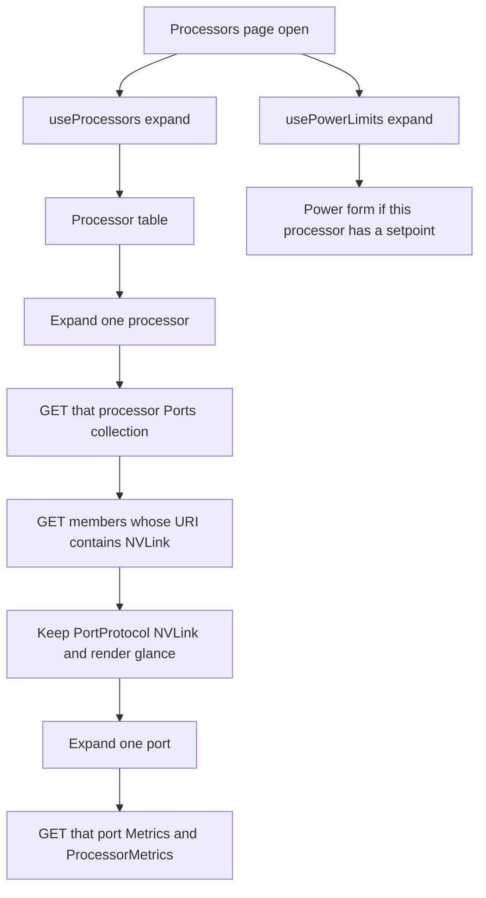

# Hardware Status Processors Page

Author: Jason Westover (Discord: jasonwestover)

Created: October 1, 2026

## Problem Description

Processor inventory lives in a table on Hardware Status > Inventory. That
table is the only place an operator can see processor health, identity, and
the identify LED, and it is fetched through a Vuex walk that does not share
the Vue Query cache.

Platforms that expose NVLink ports and processor power limits have nowhere
to show that information. A separate NVLink page would hide the processor
list on platforms that have no NVLink, and it would invite a second, more
expensive fetch of the same processor tree.

This design moves the processor table to Hardware Status > Processors on
every profile that already has Inventory. Power capping and NVLink are
blocks inside an expanded processor row. Each block is omitted when that
processor does not have the underlying Redfish data. The page does not add
a third `$expand` of the processor tree.

## Plan Review

The source plan is the right feature. These corrections come from the
current tree and are the behavior specified below.

1. **Summary columns are not the detail fields.**
   `InventoryTableProcessors.vue` shows Id, Health, State, Location, and
   (when LEDs are enabled) Identify LED. Name, type, model, part, serial,
   cores, and threads are already in the expanded row. The new page keeps
   that split.

2. **NVLink support is not known when the page opens.**
   `Processor.Ports` is an `@odata.id` link. `PortProtocol` is on the Port
   resource. The NVLink block is inside the expanded row, and it appears
   only after that processor's Ports collection is read. The page must not
   GET Ports for every processor just to decide whether a section exists.

3. **Do not load Ports through `useRedfishCollection`.**
   That hook `$expand`s the collection, or fetches every member. Either
   path pulls PCIe and CLink ports. The Ports collection GET is a listing
   with no `$expand`. Member GETs are limited to URIs that contain
   `NVLink`, and a port is kept only when `PortProtocol` is `NVLink`.

4. **Power controls are per processor, not the power-limit page's
   `hasData` flag.** `hasData` in `PowerLimit.vue` is true when any module
   has metrics. A row shows controls only when that processor's
   `EnvironmentMetrics` entry has a settable `PowerLimitWatts` range.
   The page calls `usePowerLimits()` and does not fetch
   `Processors/EnvironmentMetrics` again.

5. **Lazy query keys are Redfish path segments.**
   SSE invalidation strips `/redfish/v1/` and calls
   `invalidateQueries` with those segments (`useSSEQueryInvalidation.ts`).
   A key such as `['Redfish', portUri, 'Metrics']` does not match. Port,
   Port Metrics, and ProcessorMetrics keys are the URI split into
   segments.

6. **The identify LED does not need the Vuex processor module.**
   `processors/getProcessorsInfo` is only dispatched by the inventory
   table. On PATCH failure that action walks the collection again, outside
   the shared expand cache. The PATCH becomes a mutation against the
   processor URI. The Vuex module and its registration go away with the
   table's last caller.

7. **The processor expand key already exists; the topology page does not.**
   `useAllSubResources('/redfish/v1/Systems', 'Processors')` caches under
   `['allSubResources', '/redfish/v1/Systems', 'Processors']`.
   `useTopologyDashboard.ts` uses that key on other branches. It is not in
   this checkout. `useProcessors()` is a wrapper around that call so both
   callers share one expand when both exist. This page does not add a
   second key.

8. **Cache lifetime is the composable `staleTime`.** Both expands use 30
   seconds. Opening the page subscribes to the composables and does not
   call `refetch()`. A cache still inside `staleTime` does not send the
   expand again.

9. **Profile files in this checkout.** Inventory is registered in
   `src/router/routes.js`, `src/components/AppNavigation/AppNavigationMixin.js`,
   and the `nvidia`, `nvidia-vr`, `nvidia-gb`, `nvidia-igx`,
   `nvidia-bluefield`, `ibm`, and `intel` env router and navigation files.
   `nvidia-lp30`, `nvidia-n1x`, and `nvidia-neutrino` are not in this
   tree. The same route and nav item are added in any of those files when
   they are present. The route is not gated on a platform name or on
   NVLink.

10. **The Vera Rubin mock tree is not in this repo.** `.env.nvidia-vr`
    exists and has no mock mode. `package.json` has no `dev:vr` script.
    The LP30 mock pattern on other branches points `VITE_MOCK_DIR` at
    `./mockups/...`. The `../../../mockup/nvidia-vera-rubin-baseboard/...`
    path is for a `mockup-viewer/vendor/webui-vue` checkout. The env file
    added here uses a path relative to this repo, or is left for the
    developer to point at a local mockup checkout. It must not claim a
    directory that is not there.

## Background and References

- Processor collection expand:
  `useAllSubResources` in `src/api/composables/useRedfishCollection.ts`.
- Power limits: `src/api/composables/usePowerLimits.ts` and
  `src/env/components/nvidia/PowerLimit.vue`. Query key
  `['redfish', 'powerLimits']`. The overview card
  `OverviewPowerLimit.vue` already calls `usePowerLimits()`, so this
  expand may already be warm before either page opens.
- Current table and Vuex walk:
  `src/views/HardwareStatus/Inventory/InventoryTableProcessors.vue`,
  `src/store/modules/HardwareStatus/ProcessorStore.js`.
- Generated models: `Processor.Ports` and `Processor.Metrics` are links.
  `Port.PortProtocol`, `Port.LinkStatus`, `Port.CurrentSpeedGbps`, and
  `Port.Metrics` are on the Port resource. NVLink OEM properties are not
  in the generated models. `Oem` is `ResourceOem`. Narrow OEM interfaces
  live next to the composable, the same way `NvidiaEnvironmentMetrics`
  lives in `usePowerLimits.ts`.
- OEM property names used by this page come from the Nvidia Processor,
  Port, PortMetrics, and ProcessorMetrics schemas already under
  `mockups/nvidia-lp30-baseboard`:
  - Processor: `Oem.Nvidia.TotalNumberNVLinks`,
    `Oem.Nvidia.MNNVLinkTopology` (`ModuleID`, `PeerType`, `HostID`,
    `TraySlotNumber`, `IBGUID`, `ChassisSerialNumber`).
  - Port: `Oem.Nvidia.RXWidth`, `Oem.Nvidia.TXWidth`.
  - Port Metrics: `EarlyHealthIndication`, `EffectiveBER`,
    `NVLinkDataRxBandwidthGbps`, `NVLinkDataTxBandwidthGbps`, raw Rx/Tx
    bandwidth, `BitErrorRate`, `SymbolErrors`,
    `NVLinkErrors.RuntimeError`, `NVLinkErrors.TrainingError`,
    `LinkDownReasonCode`, `LinkDownedCount`. CPU ports use
    `PacketCRCErrors`, `PacketReplayErrors`, `BandwidthBytesPerSecond`.
  - ProcessorMetrics: `NVLinkDataRxBandwidthGbps`,
    `NVLinkDataTxBandwidthGbps`, `NVLinkRawRxBandwidthGbps`,
    `NVLinkRawTxBandwidthGbps`.
- Query key convention: `docs/designs/vue-query-integration.md`.
- Redfish reads go through Vue Query:
  `.cursor/rules/redfish-first-api-calls.mdc`.

## Requirements

### Functional

1. Hardware Status gains a Processors item on every profile that already
   has Inventory. The route is `/hardware-status/processors`, name
   `processors`. The label is "Processors".
2. The page lists the same processors the inventory table lists today,
   with the same summary columns and the same expanded identity fields.
3. Expanding a processor row shows those identity fields, then a power
   block when that processor has a settable power limit, then an NVLink
   block when that processor has NVLink ports.
4. A processor with neither feature shows only the identity fields. No
   empty NVLink table. No empty power form.
5. Expanding one NVLink port loads that port's Metrics and that
   processor's ProcessorMetrics. Expanding a second port on the same
   processor reuses the cached ProcessorMetrics response.
6. The Resource Management power-limit page stays. It and this page share
   `usePowerLimits()`. Saving a limit from the row uses `setCpuLimit` or
   `setGpuLimit`.
7. Inventory no longer shows the processor table, the processor quicklink,
   or the `hardware-status-processors-complete` gate, and it no longer
   fetches processors.
8. Sensors and the other inventory tables are unchanged.

### Non-functional

1. Opening the page starts at most the two existing expands: Processors,
   and `Processors/EnvironmentMetrics` through `usePowerLimits()`.
2. Ports and Metrics are not folded into those expands. A deeper
   `$levels` value would re-expand the processor tree on the BMC.
3. Reopening a processor row or a port row does not GET a URI that is
   still inside `staleTime`.
4. User-visible copy says "Processors" and "NVLink". It does not use an
   internal platform codename.

### Non-goals

- A Hardware Status item named NVLink.
- A link map. This UI does not require `Links.ConnectedPorts` or an
  NVLink fabric.
- FEC histograms, port Settings, or `ClearEarlyHealthIndication`.
- BIOS `NvLinkC2cLoopbackMode`, error injection, or
  `NVLinkReferenceClockEnabled`.
- A Pinia processor store.
- Reading telemetry reports, or requiring `NVLinkGUIDs`.
- Prefetching Metrics for every GPU and CPU port.
- A new privilege model. The power-limit page still has an open TODO for
  PATCH privileges. This page uses the same mutations and does not close
  that gap.

## Proposed Design

### Navigation and route

Add the route beside inventory in:

- `src/router/routes.js`
- `src/env/router/nvidia.js`
- `src/env/router/nvidia-vr.js`
- `src/env/router/nvidia-gb.js`
- `src/env/router/nvidia-igx.js`
- `src/env/router/nvidia-bluefield.js`
- `src/env/router/ibm.js`
- `src/env/router/intel.js`

Add the nav child after Inventory in:

- `src/components/AppNavigation/AppNavigationMixin.js`
- `src/env/components/AppNavigation/` for the same profile names

```
Hardware status
  Inventory
  Processors     /hardware-status/processors
  Sensors
```

Strings: `appNavigation.processors` and `appPageTitle.processors`, both
"Processors", in `src/locales/en-US.json`. NVLink and power labels get
`pageProcessors.*` keys. The moved table keeps using `pageInventory.table.*`.

The route is registered unconditionally. Platforms without NVLink still
need the page, because the processor table is leaving Inventory.

### Page composition

```
Processors.vue
  ProcessorTable.vue          useProcessors()
    row details
      inventory identity fields
      ProcessorPowerLimit.vue usePowerLimits() for this processor
      NvlinkPorts.vue         lazy Ports GETs
        NvlinkPortDetails.vue lazy Metrics GETs
```

`ProcessorTable.vue` is the current inventory table, moved under
`src/views/HardwareStatus/Processors/` and bound to `Processor` resources.
It reads PascalCase Redfish properties (`Id`, `Status.Health`,
`Status.State`, `Location.PartLocation.ServiceLabel`,
`LocationIndicatorActive`). It does not keep the Vuex camelCase
projection (`health`, `statusState`, `identifyLed`).

`ProcessorPowerLimit.vue` is a single-processor form. It is not
`PowerLimit.vue`. That file is the module-grouped page.

`NvlinkPorts.vue` chooses columns from `ProcessorType`. GPU rows use the
speed and width columns. Every other processor type uses health and state
only.

### Wireframes

These are the page states. Collapsed rows are the first paint. Power and
NVLink appear only inside a row the operator has opened, and only when
that processor has the data. The identify-LED column is drawn in the
profile wireframe that shows inventory LEDs. `nvidia-vr` and `nvidia-gb`
hide it, using the same condition as `showLeds` in `Inventory.vue`.

#### 1. Processors page, rows collapsed

This is the first paint. The Vera Rubin capture lists GPU_0–GPU_3 and
CPU_0–CPU_1. No Ports or Metrics requests have been sent.

```
+------------------------------------------------------------------+
| Hardware status                                                  |
|   Inventory                                                      |
|   Processors          <--- selected                              |
|   Sensors                                                        |
+------------------------------------------------------------------+

+------------------------------------------------------------------+
| Processors                                                       |
+------------------------------------------------------------------+
| [ Search........................ ]              Showing 6 of 6   |
+----+--------+--------+----------+-------------------------------+|
|    | Id     | Health | State    | Location                      ||
+----+--------+--------+----------+-------------------------------+|
| >  | CPU_0  | OK     | Enabled  | CPU 0                         ||
| >  | CPU_1  | OK     | Enabled  | CPU 1                         ||
| >  | GPU_0  | OK     | Enabled  | GPU 0                         ||
| >  | GPU_1  | OK     | Enabled  | GPU 1                         ||
| >  | GPU_2  | OK     | Enabled  | GPU 2                         ||
| >  | GPU_3  | OK     | Enabled  | GPU 3                         ||
+----+--------+--------+----------+-------------------------------+|
```

Profiles that show inventory LEDs add one column:

```
+----+--------+--------+----------+----------+----------+
|    | Id     | Health | State    | Location | Identify |
+----+--------+--------+----------+----------+----------+
| >  | CPU_0  | OK     | Enabled  | CPU 0    | [ off ]  |
+----+--------+--------+----------+----------+----------+
```

An empty processor list uses the existing table empty message. The page
does not disappear the way the inventory section does when
`processors.length` is 0.

#### 2. GPU row expanded, NVLink at a glance

Expanding GPU_0 loads that processor's NVLink ports and nothing else.
In the Vera Rubin capture that is 36 ports, LinkUp, 400 Gbps, width x2,
health OK. Port Metrics are not requested yet.

Power controls render only when this GPU's EnvironmentMetrics entry has
a settable range. The fields match the existing GPU form: power limit,
base power, and EDPp percent.

```
+------------------------------------------------------------------+
| v  GPU_0     OK       Enabled    GPU 0                           |
+------------------------------------------------------------------+
|  Name              GPU_0          State            Enabled       |
|  Part number       --             Health rollup    OK            |
|  Serial number     --                                           |
|  Spare part number --                                           |
|  Model             --                                           |
|  Manufacturer      NVIDIA         Min speed        --           |
|  Processor type    GPU            Max speed        -- MHz       |
|  Architecture      --             (cores and threads hidden     |
|  Instruction set   --              for ProcessorType GPU)       |
|  Version           --                                           |
+------------------------------------------------------------------+
|  Power limit                                         [ Save ]    |
|  Power limit (W)   [ 1200 ]     range 200–1200                   |
|  Base power (W)    [  800 ]     range ...                        |
|  EDPp (%)          [  100 ]     range ...                        |
+------------------------------------------------------------------+
|  NVLink                                                          |
|  Total NVLinks     36                                           |
|  Module ID         ...     Peer type     ...                    |
|  Host ID           ...     Tray slot     ...                    |
|  IB GUID           ...     Chassis SN    ...                    |
+------------------------------------------------------------------+
|     | Port      | Link status | Health | Speed    | Width       |
+-----+-----------+-------------+--------+----------+-------------+
|  >  | NVLink_0  | LinkUp      | OK     | 400 Gbps | x2          |
|  >  | NVLink_1  | LinkUp      | OK     | 400 Gbps | x2          |
|  >  | NVLink_2  | LinkUp      | OK     | 400 Gbps | x2          |
|     | ...       |             |        |          |             |
|  >  | NVLink_10 | LinkUp      | OK     | 400 Gbps | x2          |
+-----+-----------+-------------+--------+----------+-------------+
|  Sort is numeric: NVLink_2 is above NVLink_10.                  |
+------------------------------------------------------------------+
```

When `RXWidth` and `TXWidth` match, the Width cell is `x2`. When they
differ, the cell is `Rx x{n} / Tx x{m}`. A missing value is `--`.

#### 3. One GPU port expanded

Expanding NVLink_0 requests that port's Metrics and GPU_0's
ProcessorMetrics. The other 35 ports stay closed and are not fetched.

```
+------------------------------------------------------------------+
| v  NVLink_0   LinkUp    OK     400 Gbps   x2                     |
+------------------------------------------------------------------+
|  Early health indication          false                         |
|  Effective BER                    ...                           |
|  Data Rx bandwidth                ... Gbps                      |
|  Data Tx bandwidth                ... Gbps                      |
|                                                                  |
|  Processor NVLink bandwidth                                      |
|  Data Rx                          ... Gbps                      |
|  Data Tx                          ... Gbps                      |
|  Raw Rx                           ... Gbps                      |
|  Raw Tx                           ... Gbps                      |
|                                                                  |
|  Raw Rx bandwidth (port)          ...                           |
|  Raw Tx bandwidth (port)          ...                           |
|  Bit error rate                   ...                           |
|  Symbol errors                    ...                           |
|  Runtime error                    ...                           |
|  Training error                   ...                           |
|  Link down reason                 ...                           |
|  Link downed count                ...                           |
+------------------------------------------------------------------+
```

The four processor figures are `Oem.Nvidia` on ProcessorMetrics:
`NVLinkDataRxBandwidthGbps`, `NVLinkDataTxBandwidthGbps`,
`NVLinkRawRxBandwidthGbps`, `NVLinkRawTxBandwidthGbps`. They are the
processor aggregate. The port's own data bandwidth stays in the first
group. Raw port bandwidth, error counters, and link-down fields are the
secondary group.

#### 4. CPU row expanded

CPU ports are `ProcessorModule_{n}_SysBus_0_NVLink_{0-13}`. The Vera
Rubin capture has 14 of them. They do not show speed, width, or link
status. Power controls render only when this CPU has a settable
`PowerLimitWatts` range. The CPU form is the setpoint and its range,
saved with `setCpuLimit`.

```
+------------------------------------------------------------------+
| v  CPU_0     OK       Enabled    CPU 0                           |
+------------------------------------------------------------------+
|  Name              CPU_0          State            Enabled       |
|  Part number       --             Health rollup    OK            |
|  Serial number     --             Total cores      ...           |
|  Model             --             Total threads    ...           |
|  Processor type    CPU            Max speed        ... MHz       |
|  (remaining inventory fields, same as today's expanded row)      |
+------------------------------------------------------------------+
|  Power limit                                         [ Save ]    |
|  Power limit (W)   [ 400 ]      range 200–400                    |
+------------------------------------------------------------------+
|  NVLink                                                          |
|  Total NVLinks     14                                           |
|  (MNNVLinkTopology fields when the processor has them)           |
+------------------------------------------------------------------+
|     | Port                                          | Health | State   |
+-----+-----------------------------------------------+--------+---------+
|  >  | ProcessorModule_0_SysBus_0_NVLink_0           | OK     | Enabled |
|  >  | ProcessorModule_0_SysBus_0_NVLink_1           | OK     | Enabled |
|     | ...                                           |        |         |
|  >  | ProcessorModule_0_SysBus_0_NVLink_13          | OK     | Enabled |
+-----+-----------------------------------------------+--------+---------+
```

Expanding one CPU port loads that port's Metrics only for the CPU
fields:

```
+------------------------------------------------------------------+
| v  ProcessorModule_0_SysBus_0_NVLink_0     OK      Enabled       |
+------------------------------------------------------------------+
|  Packet CRC errors                ...                           |
|  Packet replay errors             ...                           |
|  Bandwidth                        ... B/s                       |
+------------------------------------------------------------------+
```

CPU port rows do not show the GPU bandwidth or error groups.

#### 5. Processor with no NVLink and no settable power limit

This is the expanded row on a platform whose Ports collection has no
NVLink member, and whose EnvironmentMetrics entry is missing or has no
allowable range. Inventory detail is the whole row.

```
+------------------------------------------------------------------+
| v  CPU_0     OK       Enabled    CPU 0                           |
+------------------------------------------------------------------+
|  Name              CPU_0          State            Enabled       |
|  Part number       ...            Health rollup    OK            |
|  Serial number     ...            Total cores      ...           |
|  Model             ...            Total threads    ...           |
|  Processor type    CPU            Max speed        ... MHz       |
+------------------------------------------------------------------+
```

There is no "NVLink unavailable" message and no disabled power form.

### What loads when



| When | Request | Query key |
| --- | --- | --- |
| Page open | Existing Processors `$expand` | `['allSubResources', '/redfish/v1/Systems', 'Processors']` |
| Page open | Existing EnvironmentMetrics `$expand`, plus the Chassis collection already inside `usePowerLimits()` | `['redfish', 'powerLimits']` and the existing Chassis collection key |
| Processor row opens | GET `Processor.Ports['@odata.id']` with no `$expand` | Path segments of that collection URI |
| After the listing | GET each member URI that contains `NVLink` | Path segments of that port URI |
| Port row opens | GET `{port}/Metrics` and `Processor.Metrics['@odata.id']` | Path segments of each Metrics URI. `enabled` is that port row |

`useProcessors()`:

```ts
export function useProcessors() {
  return useAllSubResources<Processor>(
    '/redfish/v1/Systems',
    'Processors',
  );
}
```

The page and any topology view that calls `useAllSubResources` with the
same arguments share one in-flight request and one result. Do not call
`fetchAllSubResources` from the page. Do not expand
`Processors/EnvironmentMetrics` from `useProcessors()`.

The Ports listing is a `useQuery` around `apiInstance`, not
`useRedfishCollection`. `enabled` is the expanded processor's Ports URI.
Member queries are `enabled` for the filtered URI list of that processor.
Metrics queries are `enabled` only for the open port URI. ProcessorMetrics
is `enabled` while any NVLink port row of that processor is open, and is
keyed by the Metrics URI so each further port reuses it.

A warm cache inside `staleTime` (30 seconds on these composables) does
not refetch. Do not shorten `staleTime` and do not call `refetch()` on
mount.

### Power block

Match a processor to metrics by URI:

`{processor['@odata.id']}/EnvironmentMetrics`

Show the block when that entry's `PowerLimitWatts.AllowableMin` and
`AllowableMax` are numbers. GPU rows also show `Oem.Nvidia.BasePowerWatts`
and `Oem.Nvidia.EDPpPercent` when those objects are present, and save
through `setGpuLimit`. CPU rows save through `setCpuLimit`. Setpoints go
through `normalizeSetPoint` before they are shown, same as
`PowerLimit.vue`.

The processor table does not wait on the power-limit query. If that query
errors or returns nothing, every power block stays hidden and the table
still renders.

### NVLink block

1. GET the Ports collection. Members are `@odata.id` links.
2. Keep URIs that contain `NVLink`. This drops `PCIe_*` and `CLink_*`
   without GETting them.
3. GET the remaining ports. Keep `PortProtocol === "NVLink"`.
4. If the kept list is empty, render nothing.
5. Sort by the trailing integer in `Id`, so `NVLink_2` precedes
   `NVLink_10`. The same sort applies to
   `ProcessorModule_0_SysBus_0_NVLink_2`.

Glance cells come from the Port resource. `TotalNumberNVLinks` and
`MNNVLinkTopology` come from the processor already loaded by
`useProcessors()`. Missing topology properties are omitted rather than
shown as a blank group.

### Identify LED

The checkbox is shown under the same condition Inventory uses today:
hidden when `VITE_ENV_NAME` is `nvidia-gb` or `nvidia-vr`, and hidden
when `VITE_HIDE_INVENTORY_LED` is true. Otherwise it is shown when
`LocationIndicatorActive` is a boolean.

The change is a `useMutation` PATCH of `{ LocationIndicatorActive }` to
the processor URI. On success, write the value into the processors query
cache. On failure, invalidate
`['allSubResources', '/redfish/v1/Systems', 'Processors']` so the switch
returns to the server value. That invalidation is the error path only.

Remove `ProcessorStore.js` and its `processors` registration in
`src/store/index.js`. Nothing else dispatches it.

### Inventory

In `Inventory.vue`, remove `table-processors`, the processors quicklink,
and `hardware-status-processors-complete` from the load gate. The other
tables and quicklinks stay, including sensors.

### Mock profile

Add `.env.nvidia-vr.mock` by copying the flags from `.env.nvidia-vr` and
setting:

- `VITE_ENV_NAME=nvidia-vr`
- `VITE_MOCK_MODE=true`
- `VITE_MOCK_DIR` to the Vera Rubin BMC+HMC `redfish` directory

Add `"dev:vr": "vite --mode nvidia-vr.mock"` to `package.json`.

If the mockup is checked out inside this repo, `VITE_MOCK_DIR` follows
the LP30 shape, for example
`./mockups/nvidia-vera-rubin-baseboard/BMC+HMC/redfish`. That directory
is not in the tree today. Until it is, the env file documents the
variable and the browser check runs against a local checkout of the
mockup. Do not commit the `mockup-viewer/vendor/webui-vue` relative path
as if it resolved here.

### Tests

Unit-test the pure helpers:

- URI contains `NVLink`, then `PortProtocol === "NVLink"` keeps the port.
- A `PCIe_*` or `CLink_*` URI is not fetched and is not kept.
- An empty kept list hides the NVLink block.
- Numeric port sort.
- Missing allowable min or max hides the power block.
- A matching EnvironmentMetrics URI with a range shows it.
- Equal widths format as `x2`. Unequal widths show both.

Browser check with `npm run dev:vr`, watching the network log:

- Hardware Status contains Processors and does not contain an NVLink item.
- Inventory has no processor table and no processor quicklink.
- The processor table lists GPU_0–GPU_3 and CPU_0–CPU_1.
- First paint does not request port Metrics, and it does not `$expand`
  Ports.
- One Processors expand, shared with topology when that cache is warm.
- One `Processors/EnvironmentMetrics` expand, shared with the power-limit
  page and the overview card when that cache is warm.
- Expanding a GPU GETs that GPU's NVLink ports only, and shows
  `TotalNumberNVLinks` and `MNNVLinkTopology`.
- Expanding one port GETs that port's Metrics. Expanding it again does
  not.
- Expanding a CPU shows 14 system-bus ports and no GPU speed columns.
- Power controls appear only for processors `usePowerLimits` can edit.
- The existing power-limit page still saves.
- Sensors still load.

Before any commit, run the forbidden-codename scan in
`.cursor/rules/commit-format-rule.mdc`.
